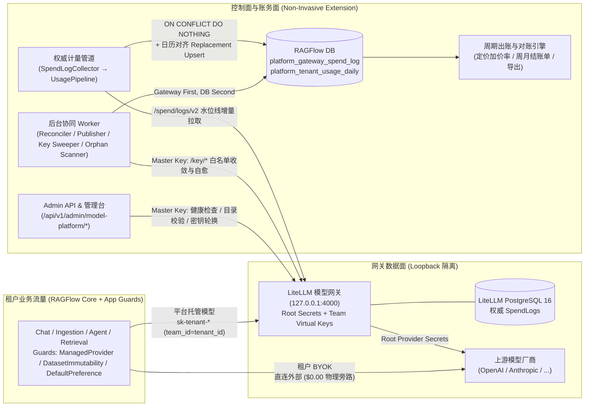

# 多租户模型计量与定期出账系统架构设计

> **研究基线**：RAGFlow [`v1.0.0`](https://github.com/infiniflow/ragflow/releases/tag/v1.0.0)（commit `db1cd5929a7885a3074547791f5ecc4d2f891739`）
> **适用场景**：RAGFlow 公有云多租户售卖、平台统一采买模型资源 + 租户 BYOK 并存、后付费定期出账（Post-paid Periodic Invoicing）
> **核心原则**：单一权威真相源、物理凭证隔离、BYOK 零计费旁路、非侵入上游演进、财务级幂等对账
> **参考实现**：`oh-my-ragflow/extensions/model-platform`（隔离 LiteLLM 网关 + 非侵入控制面 + 权威水位线采集）

---

## 一、背景与商业诉求

平台作为大模型基础设施运营商，在各大云厂商（OpenAI、Anthropic、阿里云、火山引擎等）统一采购模型资源，面向企业/团队租户提供基于 RAGFlow 的知识库检索、文档解析与 Agent 能力，同时允许租户自行配置 Bring Your Own Key（BYOK）模型。

- **结算模式**：**后付费（Post-paid）定期结算**，按周或按月向租户出具可对账的消费账单，并支持平台核算单客成本与毛利。
- **核心诉求**：
  1. **权威精准归属**：全量托管模型（`chat`、`embedding`、`asr`、`vision`、`rerank`、`tts`、`decision`）的每次调用必须 100% 准确归属到租户，不因应用层漏传上下文或进程重启而丢账、错账。
  2. **凭证安全与 BYOK 隔离**：上游厂商 Root API Key 绝不暴露给租户或散落在业务库中；租户自带 BYOK 流量必须严格 `$0.00` 平台计费，避免误计费客诉。
  3. **覆盖现代计费维度**：完整计量输入/输出 Token、Prompt Caching 读/写与缓存节省、Reasoning Token、TTS 字符数及真实花费。
  4. **非侵入式演进**：保持 RAGFlow 上游内核纯净（`upstream/ragflow` 零改动），通过标准扩展点、overlay 与外置服务集成，降低长期跟进上游版本的维护成本。

---

## 二、架构选型：隔离模型网关 vs 应用内建账本

在多租户后付费计量场景下，常见两条技术路线：

- **方案 A（推荐）：回环隔离的模型网关 + 非侵入控制面 + 权威水位线采集**（如基于 LiteLLM 网关）
- **方案 B（不推荐）：RAGFlow 应用内建异步账本**（在模型驱动层拦截写库）

### 2.1 第一性原理：计费真相源必须位于不可绕过的资源边界

计费数据属于财务资产，其采集点不应散落在几十个业务调用入口和上百个驱动实现里，而应放在**模型资源实际被消费且不可绕过的统一出口**。

在“统一采买 + 多租户托管 + BYOK 共存”的真实场景中，隔离模型网关的价值远不只是“预付费余额拦截”，而是同时解决**计量权威性、凭证安全边界、BYOK 物理旁路、多厂商协议演进与上游非侵入集成**五个基础问题。

### 2.2 源码实测事实：RAGFlow `v1.0.0` 内部计量基础设施尚不完备

针对 `upstream/ragflow`（`v1.0.0`，commit `db1cd5929a`）的源码审计表明，RAGFlow 内部 Token 计量链路存在系统性断层，远不足以承担商业出账底座：

| 断层环节 | `upstream/ragflow`（`v1.0.0`）源码实测事实 | 对商业出账的影响 |
| :--- | :--- | :--- |
| **1. 采集终点为空桩** | `upstream/ragflow/internal/entity/models/base_model.go:148` 最终调用 `driver.CollectModelUsage(modelUsage)`，社区版 `upstream/ragflow/internal/engine/clickhouse/stub.go:31` 直接 `return nil`。 | 社区版无可用持久化底座，需自建完整落库与对账链路。 |
| **2. 归属注入链断链** | `upstream/ragflow/internal/entity/models/types.go` 各模型包装层在 `v1.0.0` 中直接透传调用方 `usage`；`internal/service/`、`internal/ingestion/`、`internal/agent/` 中共 43 处驱动调用里有 **38 处直接传 `nil`**；`base_model.go:109` 在 `modelUsage == nil` 时仅构造空结构体，导致 `TenantID` 与 `UserID` 为空。 | 后台异步任务、队列消费与跨租户知识库检索大量脱离 HTTP Request Context，仅靠中间件透传 `TenantID` 无法保证不断链，极易漏账或算错主体。 |
| **3. 模态覆盖缺口** | 整个 `upstream/ragflow/internal/entity/models/` 下 **0 个** ASR/TTS 驱动方法调用了 `recordResponseUsage` 或 `collectModelUsage`，`ASRModel`（`types.go:703`）与 `TTSModel`（`types.go:741`）传入的 `modelUsage` 被静默忽略。 | 无法覆盖 7 类托管模型中的语音模态。 |
| **4. 驱动层极度碎片化** | `upstream/ragflow/internal/entity/models/` 下共有 **116 个**非测试 Go 文件。多家驱动（`voyage.go`、`xinference.go`、`azure_openai.go`、`mistral.go`、`zhipu-ai.go`、`upstage.go`、`nvidia.go` 等）未接入 `recordResponseUsage`/`collectModelUsage`；`anthropic.go:466-504` 仅读取 `input_tokens`，未计入 `cache_creation_input_tokens` 与 `cache_read_input_tokens`。 | 补齐成本极高，且上游每次新增驱动或业务调用点都可能静默漏计，长期维护风险不可控。 |
| **5. 财务语义与可靠性不足** | 应用侧 best-effort 内存缓冲队列在满载、进程 OOM 或异常重启时会直接丢记录；且 `TokenUsage` 仅含基础三项，无法可靠区分缓存读/写、思考 Token、字符计费及“未返回 vs 真实零”。 | 无法满足财务对账要求的“不丢账、不重账、可追溯”。 |

### 2.3 多租户模型托管的三大刚性边界

1. **物理凭证隔离（Zero-Leakage Credential Boundary）**：上游厂商 Root API Key 严格保存在回环网关容器环境变量中；RAGFlow 业务库仅保存租户级受限虚拟 Key（`sk-tenant-*`），支持单租户与批量零停机紧急轮换以及退租即时吊销。
2. **BYOK 物理零计费旁路（Physical Zero-Billing Bypass）**：平台托管模型通过原生 `OpenAI-API-Compatible` 驱动指向回环网关，BYOK 模型直连外部厂商端点。BYOK 流量物理上不经过网关，天然保证 `$0.00` 平台费用，并支持在线影子审计。
3. **非侵入式上游集成**：将控制面、守卫中间件与管理台封装在扩展层，通过 Go `//go:build ee` stubs/trampolines 与前端 `src/ee` overlay 接入，保持 `upstream/ragflow` 零差异，彻底规避深度修改内核带来的升级冲突。

### 2.4 方案对比总览

| 比较维度 | 方案 A：隔离模型网关 + 非侵入控制面（推荐） | 方案 B：RAGFlow 内建异步账本 | 结论 |
| :--- | :--- | :--- | :--- |
| **计量完整性与权威性** | 7 类平台模型全部收口至单一网关，按 `team_id = tenant_id` 强制归属；无视上层是否传 `modelUsage` 或断 `ctx` | 依赖上百个驱动与几十个业务入口全部补齐并持续不回归 | **方案 A 胜出** |
| **凭证安全边界** | Root Key 锁死在 `127.0.0.1:4000` 网关；租户仅持 scoped 虚拟 Key，支持零停机轮换与吊销 | 无天然凭证隔离，Root Key 易耦合在业务库中 | **方案 A 胜出** |
| **BYOK 共存隔离** | 物理旁路，BYOK 直连外部端点，严格 `$0.00` 平台费 | 需在驱动拦截层做复杂条件过滤，存在误计费风险 | **方案 A 胜出** |
| **财务数据可靠性** | 网关独立 PostgreSQL 持久化 `SpendLogs` + 水位线采集 + `spend_id` 幂等去重 + 日历对齐替换式聚合 + 多日自动追平 | 内存队列满载/崩溃即丢数据，重试边界难对齐 | **方案 A 胜出** |
| **网络延迟开销** | 同机回环 `127.0.0.1:4000` 本地 HTTP 转发，开销亚毫秒级，相对秒级 LLM 推理可忽略 | 0 额外网络跳数 | **差距可忽略** |
| **多厂商协议与定价维护** | 复用开源 LiteLLM 网关（缓存读/写、思考 Token、TTS 字符、spend 与 cache savings） | 需在 RAGFlow 内部长期自研并维护各厂商协议与定价表 | **方案 A 胜出** |
| **上游侵入与升级成本** | `upstream/ragflow` 保持 0 diff | 深度改造核心包与数十个驱动，升级冲突重 | **方案 A 胜出** |
| **运维复杂度 / SPOF** | 需维护 LiteLLM + 专属 PostgreSQL（BYOK 流量不受网关故障影响） | 无额外独立网关进程 | **方案 B 占优**（网关需配合监控与高可用） |
| **业务上下文粒度** | 网关原生可见 `tenant_id`、`model_name`、`call_type`，不含 `dataset_id`/`source` | 若链路完整可直取知识库/任务/Agent 上下文 | **方案 B 占优**（见第五节演进策略） |

---

## 三、目标架构蓝图

参照 `oh-my-ragflow/extensions/model-platform` 的分层架构，系统划分为**业务流量层、网关数据面、非侵入控制与账务面**三层：



### 核心工程不变量

1. **租户凭据与生命周期解耦**：
   - 租户密钥统一按 LiteLLM `team_id = tenant_id` 归组，单把密钥按 SHA-256 `key_hash` 寻址，控制面与 Admin API 永不暴露明文密钥。
   - 严禁在数据库事务内发起远程 RPC：租户创建钩子仅写本地 `platform_tenant_reconcile`（`status = pending`），提交可见后通过事件快速路径 + DB 驱动退避轮询实现自愈；支持单租户与批量零停机密钥轮换及孤儿租户自动清理。
2. **7 类托管模型与向量空间保护**：
   - 通过原生 `OpenAI-API-Compatible` → `platform` 实例托管 `chat`（1）、`embedding`（2）、`asr`（4）、`vision`（8）、`rerank`（16）、`tts`（32）、`decision`（128）；本地 `ocr`（64）保留在网关之外。
   - 目录变更遵循 **Gateway First, DB Second**；默认模型升级通过 `StickyGuard` 保护用户显式选择；非空知识库禁止变更 Embedding，退场 Embedding 走 `Active → Deprecated (只读) → Tombstoned` 三态收敛，避免破坏存量知识库检索。
3. **写保护与 BYOK 零计费审计**：
   - 前后端守卫禁止租户修改/删除平台托管 `platform` 实例，同时完全保留租户管理 BYOK 实例的自由。
   - 提供在线隔离审计接口（`GET /api/v1/admin/model-platform/usage/audit`），持续核验 BYOK 流量未产生任何平台侧费用。

---

## 四、计量数据面与周期出账设计

### 4.1 权威流水采集与幂等日聚合

计量管道采用**两层存储 + 水位线拉取 + 替换式聚合**设计，保证重跑不加倍、断网重启可自动追平：

#### 1) 原始流水暂存表（`platform_gateway_spend_log`）

按 `spend_id` 主键执行 `ON CONFLICT DO NOTHING` 批量幂等落库，完整留存细粒度计费维度与原始载荷：

```sql
CREATE TABLE IF NOT EXISTS platform_gateway_spend_log (
    spend_id           VARCHAR(128) PRIMARY KEY,
    tenant_id          VARCHAR(64) NOT NULL,
    api_key            VARCHAR(128) NULL,
    key_alias          VARCHAR(128) NULL,
    model_name         VARCHAR(128) NOT NULL,
    call_type          VARCHAR(64) NULL,
    prompt_tokens      INT NOT NULL DEFAULT 0,
    completion_tokens  INT NOT NULL DEFAULT 0,
    total_tokens       INT NOT NULL DEFAULT 0,
    cached_tokens      INT NOT NULL DEFAULT 0,
    cache_write_tokens INT NOT NULL DEFAULT 0,
    reasoning_tokens   INT NOT NULL DEFAULT 0,
    characters         BIGINT NOT NULL DEFAULT 0,
    spend              DECIMAL(14, 6) NOT NULL DEFAULT 0.000000,
    prompt_spend       DECIMAL(14, 6) NOT NULL DEFAULT 0.000000,
    completion_spend   DECIMAL(14, 6) NOT NULL DEFAULT 0.000000,
    cache_savings      DECIMAL(14, 6) NOT NULL DEFAULT 0.000000,
    request_time       DATETIME NOT NULL,
    raw_payload        TEXT NULL,
    created_at         DATETIME NOT NULL,
    INDEX idx_spend_tenant_time (tenant_id, request_time),
    INDEX idx_spend_time (request_time),
    INDEX idx_spend_alias (key_alias),
    INDEX idx_spend_model (model_name)
);
```

#### 2) 日历对齐日汇总表（`platform_tenant_usage_daily`）

以 `(tenant_id, model_name, usage_date)` 为联合主键，按 `METERING_TIMEZONE` 日历日做**替换式 Upsert（Replacement Upsert）**，彻底消除增量 `+=` 在重试/回放时造成的重复加账风险：

- **常规轮询**：`SpendLogCollector` 定期（默认 `5m`）向 LiteLLM `/spend/logs/v2` 拉取 `[lastCheckedAt - METERING_FETCH_OVERLAP, Now]` 窗口内的流水。
- **冷启动与重启恢复**：冷启动对齐到 `METERING_LOOKBACK_HOURS`（默认 `48h`）前的自然日零点；进程重启后从本地 `MAX(request_time) - METERING_FETCH_OVERLAP` 无上限回放；若新写入记录早于常规回看窗口，自动触发多日动态追平聚合（catch-up）。
- **运维边界**：
  - `METERING_FETCH_OVERLAP`（默认 `5m`）应大于网关日志落盘延迟；网关保留期（`maximum_spend_logs_retention_period`）应长于最大可容忍故障恢复时间。
  - 若开启明细表清理（`METERING_SPEND_LOG_RETENTION_DAYS`），执行历史重聚合前须确认目标日期范围内的原始流水未被裁剪，避免替换式聚合覆盖已归档的完整日汇总。

### 4.2 周期出账与毛利核算

周期出账引擎（周结/月结 Cron 与 Admin 导出 API）直接消费 `platform_tenant_usage_daily`，与模型推理主链路完全解耦：

#### 1) 周期汇总查询

```sql
SELECT
    tenant_id,
    model_name,
    SUM(call_count)         AS total_calls,
    SUM(prompt_tokens)      AS prompt_tokens,
    SUM(completion_tokens)  AS completion_tokens,
    SUM(cached_tokens)      AS cached_tokens,
    SUM(cache_write_tokens) AS cache_write_tokens,
    SUM(reasoning_tokens)   AS reasoning_tokens,
    SUM(characters)         AS tts_characters,
    SUM(total_spend)        AS upstream_cost,
    SUM(prompt_spend)       AS upstream_prompt_cost,
    SUM(completion_spend)   AS upstream_completion_cost,
    SUM(cache_savings)      AS cache_savings
FROM platform_tenant_usage_daily
WHERE tenant_id = ?
  AND usage_date >= '2026-10-01'
  AND usage_date <  '2026-11-01'
GROUP BY tenant_id, model_name;
```

#### 2) 租户结算与毛利公式

平台可通过独立定价目录（按租户等级或模型维度配置零售单价或加价系数 `markup_rate`）将上游基准成本转换为租户应收账单：

- **按成本加成模式**：
  $$\text{应收金额} = \sum_{\text{model}} \text{upstream\_cost}_{\text{model}} \times (1 + \text{markup\_rate}_{\text{tenant, model}})$$
- **按细分单价模式**（适用于自定义阶梯价或独立缓存/字符定价）：
  $$\text{应收金额} = \sum_{\text{model}} \Big( \text{normal\_input} \times P_{\text{in}} + \text{cached} \times P_{\text{cache\_read}} + \text{cache\_write} \times P_{\text{cache\_write}} + \text{completion} \times P_{\text{out}} + \text{characters} \times P_{\text{char}} \Big)$$
  其中 $\text{normal\_input} = \max(0, \text{prompt\_tokens} - \text{cached\_tokens} - \text{cache\_write\_tokens})$；`reasoning_tokens` 已包含于输出侧，单独列示以提升账单透明度。
- **单客毛利**：
  $$\text{毛利} = \text{应收金额} - \sum \text{upstream\_cost}, \quad \text{毛利率} = \frac{\text{毛利}}{\text{应收金额}}$$

---

## 五、已知边界与演进方向

### 5.1 细粒度业务成本归因（Dataset / Task / Agent 维度）

当前网关流水天然记录 `tenant_id`、`model_name`、`call_type` 与精准费用，但不感知 RAGFlow 内部的 `dataset_id`、`task_id` 或业务来源（Chat / Ingestion / Rerank / Agent）。当商业化需要提供“分部门/分知识库成本拆解报表”时，采用以下两条低耦合演进路径：

1. **网关元数据透传（首选）**：在 RAGFlow 上游或扩展点具备非侵入式请求 Header 透传能力后，将 `dataset_id`、`source` 等标签写入 LiteLLM `metadata`，直接随权威 `SpendLogs` 落库。
2. **总账与分摊分离（双层对账）**：始终以网关账本作为**财务结算总账（100% 权威）**；应用侧 usage 事件仅用于**业务维度占比分摊（Analytics）**，绝不让不完备的应用侧记录直接决定应收金额。

### 5.2 RAGFlow 内部计量可观测性演进

RAGFlow 内部计量链路的补全（跨租户模型凭证归属修正、VLM/Agent 产品分类传递、Anthropic 缓存与流式修正、各驱动 usage 补齐）应作为**上游开源可观测性改进**独立推进，服务于诊断分析与社区生态，而非替代网关承担商业出账职责。

### 5.3 商业化结算闭环扩展

在 `platform_tenant_usage_daily` 之上，后续可独立叠加：
- 租户定价策略与合同折扣表（`billing_price_catalog`）；
- 周结/月结出账作业、账单快照与不可变归档（PDF / Excel / 对账 API）；
- 异常用量预警与可选的虚拟 Key 预算上限（Soft Alert / Hard Cap）。

---

## 六、总结

多租户公有云模型计量与定期出账的核心，不在于省去一个本地代理进程，而在于**把财务真相源建立在不可绕过、安全隔离、协议完备且幂等可追平的边界上**。

采用 **“回环隔离 LiteLLM 网关 + 非侵入控制面 + 水位线权威采集与替换式日聚合 + 解耦周期出账”** 架构：
1. 彻底绕开 RAGFlow 内部计量链路断层与上百个驱动碎片化带来的漏账风险；
2. 同时满足 Root Key 物理隔离、BYOK `$0.00` 物理旁路、7 类模型全生命周期治理与上游零侵入演进；
3. 为定期推账单、客户透明对账与平台毛利核算提供财务级可靠的数据底座。
