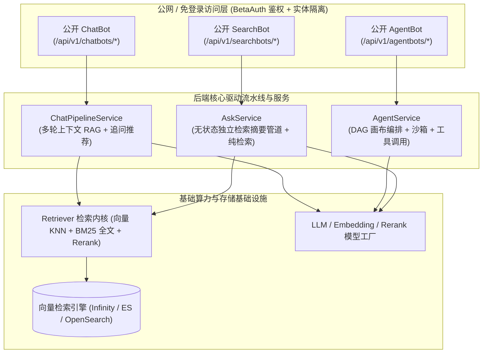
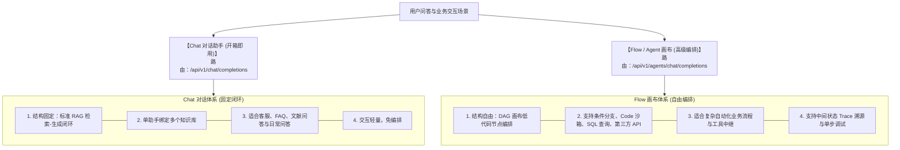

# RAGFlow API 全景能力与接口参考手册

> **研究基线**：RAGFlow [`v1.0.0`](https://github.com/infiniflow/ragflow/releases/tag/v1.0.0)（commit `db1cd5929a7885a3074547791f5ecc4d2f891739`）
> **核心源码依据**：`upstream/ragflow/internal/router/router.go`、`upstream/ragflow/internal/router/agent_routes.go`、`upstream/ragflow/internal/admin/router.go`、`upstream/ragflow/internal/common/error_code.go`

本手册基于 RAGFlow `v1.0.0` Go 统一后端架构编写，系统性梳理 RAGFlow 对外暴露的 RESTful API、SSE 流式接口、OpenAI 兼容协议以及外部生态集成端点，并对照说明默认前端（Web UI）的消费映射。

---

## 目录

- [一、全局协议与认证规范](#一全局协议与认证规范)
- [二、知识库与多模态检索能力组 (Dataset & Retrieval)](#二知识库与多模态检索能力组-dataset--retrieval)
- [三、文档管理与解析流水线能力组 (Document & Ingestion)](#三文档管理与解析流水线能力组-document--ingestion)
- [四、切片与知识块微调能力组 (Chunk Management)](#四切片与知识块微调能力组-chunk-management)
- [五、对话助手与会话交互能力组 (Chat & Session)](#五对话助手与会话交互能力组-chat--session)
- [六、Agent 智能体与画布工作流能力组 (Agent & Canvas)](#六agent-智能体与画布工作流能力组-agent--canvas)
- [七、公开分享与免登录 Bot 能力组 (Public Bots)](#七公开分享与免登录-bot-能力组-public-bots)
- [八、模型算力与推理直调能力组 (Models & Providers)](#八模型算力与推理直调能力组-models--providers)
- [九、长期记忆与技能空间能力组 (Memory & Skills)](#九长期记忆与技能空间能力组-memory--skills)
- [十、网盘文件与 Git 风格版本快照能力组 (Files & Commits)](#十网盘文件与-git-风格版本快照能力组-files--commits)
- [十一、外部生态与多协议集成能力组 (Ecosystem Integrations)](#十一外部生态与多协议集成能力组-ecosystem-integrations)
- [十二、认证、租户与系统运维能力组 (Auth, Tenant & System)](#十二认证租户与系统运维能力组-auth-tenant--system)
- [十三、默认前端 (Web UI) 与 API 能力组的消费映射](#十三默认前端-web-ui-与-api-能力组的消费映射)

---

## 一、全局协议与认证规范

### 1.1 鉴权机制

RAGFlow API 分为三类路由组（见 `upstream/ragflow/internal/router/router.go:154-230`）：

1. **无需认证组（`apiNoAuth`）**：探活、公开系统信息、登录注册、外部 OAuth 回调、公开 Webhook 触发与搜索机器人元信息。
2. **Beta Token 认证组（`apiBetaAuth`，`BetaAuthMiddleware`）**：用于公网分享的免登录 Bot（`chatbots` / `agentbots` / `searchbots`）、共享会话图片/附件预览与 MCP Server 端点（`POST /api/v1/mcp`）。
3. **受保护认证组（`authorized`，`AuthMiddleware`）**：支持用户会话 JWT Token（Web 控制台）与租户 API Key（`Authorization: Bearer <YOUR_API_KEY>`，推荐系统集成使用）。

### 1.2 响应外壳格式

标准业务接口采用统一 JSON 外壳结构（OpenAI 兼容接口及文件流下载除外）：

```json
{
  "code": 0,
  "message": "success",
  "data": {}
}
```

### 1.3 核心状态与业务错误码

定义见 `upstream/ragflow/internal/common/error_code.go:28-55`：

| HTTP 状态码 | 业务 Code | 说明 |
| :--- | :--- | :--- |
| 200 | 0 | 请求成功处理 |
| 400 | 101 / 400 | 参数缺失或校验失败（`CodeArgumentError` / `CodeBadRequest`） |
| 401 | 109 / 401 | 未授权、API Key 无效或过期（`CodeAuthenticationError` / `CodeUnauthorized`） |
| 403 | 108 / 403 | 权限不足（如非租户成员或跨权限访问） |
| 404 | 102 / 404 | 数据或资源未找到 |
| 500 | 100 / 500 | 服务器处理异常 |

### 1.4 身份认证与账号接口 (Auth & Account)

路由定义见 `upstream/ragflow/internal/router/router.go:167-260`：

| 请求方法 | 路由路径 | 功能说明 |
| :--- | :--- | :--- |
| `POST` | `/api/v1/auth/login` | 邮箱密码登录，返回会话 Token 与设置 Cookie |
| `POST` | `/api/v1/users` | 用户新账号注册 |
| `POST` | `/api/v1/auth/logout` | 注销当前用户登录会话 |
| `GET` | `/api/v1/users/me` | 获取当前登录用户的个人资料与租户身份 |
| `PATCH` | `/api/v1/users/me` | 更新当前用户的个人配置（昵称、头像等） |
| `GET` | `/api/v1/users/me/models` | 获取当前租户绑定的模型列表与默认配置 |
| `PATCH` | `/api/v1/users/me/models` | 设置当前租户默认模型与偏好 |
| `GET` | `/api/v1/users/me/admin` | 查询当前用户是否具备管理员身份 |
| `GET` | `/api/v1/users/me/meta` | 获取当前用户扩展元信息 |
| `GET` | `/api/v1/settings/enable-admin` | 查询当前实例是否启用了 Admin 后台 |

> 注：社区版 `v1.0.0` 主路由中未注册自助找回密码（forgot password / OTP）接口；密码重置由管理员通过 Admin API `PUT /api/v1/admin/users/:username/password` 或企业版扩展路由（`RegisterEENoAuthRouter`）提供。

---

## 二、知识库与多模态检索能力组 (Dataset & Retrieval)

知识库是 RAGFlow 存储、分块、索引与向量召回的核心载体（路由见 `upstream/ragflow/internal/router/router.go:321-415`）。

> **检索流程是否有 LLM 参与？**
> - **常规基础检索（默认模式）**：**0 个 LLM 生成 Token 消耗**。仅通过 Embedding 向量模型做 KNN 相似度计算、分词器做 BM25 全文检索，以及可选的 Rerank 模型进行交叉打分重排，直接返回文档切片（Chunks）。
> - **高级增强检索（可选参数）**：开启 `metadata_filter: auto/semi_auto`（自然语言自动抽取元数据过滤条件）、`cross_languages`（多语言自动翻译）或 `keyword: true`（关键词抽取与 Query 扩展）时，底层会调用轻量 LLM 辅助进行前置 Query 理解与改写。

### 2.1 知识库与检索接口

| 请求方法 | 路由路径 | 功能说明 |
| :--- | :--- | :--- |
| `GET` | `/api/v1/datasets` | 获取知识库列表（支持分页、关键词与标签过滤） |
| `POST` | `/api/v1/datasets` | 创建新的知识库（指定 Embedding 模型、解析方案与权限） |
| `GET` | `/api/v1/datasets/:dataset_id` | 获取指定知识库的详细配置 |
| `PUT` | `/api/v1/datasets/:dataset_id` | 修改知识库配置（重排设置、Top-k、描述信息等） |
| `DELETE` | `/api/v1/datasets` | 批量删除指定知识库 |
| `POST` | `/api/v1/datasets/:dataset_id/search` | **单库检索**：支持向量语义召回、关键字全匹配与加权重排 |
| `POST` | `/api/v1/datasets/search` | **跨多库联合检索**：请求体传入多个 `dataset_ids` 联合召回 |
| `POST` | `/api/v1/retrieval` | 检索别名接口（指向同一 `SearchDatasets` 处理器） |
| `POST` | `/api/v1/datasets/:dataset_id/embedding/check` | 验证当前绑定的 Embedding 模型是否连通可用 |
| `GET` | `/api/v1/datasets/:dataset_id/graph` | 获取知识库生成的知识图谱关联网络 |
| `GET` | `/api/v1/datasets/tags/aggregation` | 聚合知识库下的标签与分类统计 |
| `GET` | `/api/v1/datasets/metadata/flattened` | 获取知识库体系下已建立的扁平元数据字段池 |
| `GET` | `/api/v1/datasets/:dataset_id/metadata/summary` | 获取知识库元数据统计概览 |
| `GET` | `/api/v1/datasets/:dataset_id/metadata/config` | 查询当前知识库元数据键定义与规范 |
| `PUT` | `/api/v1/datasets/:dataset_id/metadata/config` | 更新知识库元数据过滤规则与提取字段配置 |
| `POST` | `/api/v1/datasets/:dataset_id/metadata/update` | 批量更新知识库切片元数据 |
| `PATCH` | `/api/v1/datasets/:dataset_id/documents/metadatas` | 批量更新文档元数据配置 |
| `GET` | `/api/v1/datasets/:dataset_id/compilation/status` | 查询知识库深度编译（Knowledge Compilation）状态 |
| `GET/HEAD` | `/api/v1/datasets/:dataset_id/artifacts` | 检查或列出知识编译产出的产物（如 Topic Wiki / Structure） |
| `GET/PUT` | `/api/v1/datasets/:dataset_id/artifacts/:page_type/*slug` | 读取或更新指定编译产物页面 |
| `GET` | `/api/v1/datasets/:dataset_id/navigation` | 获取知识编译构建的多级知识大纲导航树 |
| `GET/DELETE` | `/api/v1/datasets/:dataset_id/skills` | 获取或清理知识编译产出的技能树 |

### 2.2 搜索应用管理 (Search App Management)

用于管理聚合了多个知识库的搜索引擎式应用（对应前端顶部的 `Search` 菜单，`router.go:407-415`）：

| 请求方法 | 路由路径 | 功能说明 |
| :--- | :--- | :--- |
| `GET` | `/api/v1/searches` | 获取当前用户的搜索应用列表（支持关键词搜索、分页与排序） |
| `POST` | `/api/v1/searches` | 创建新的搜索应用（绑定知识库 `kb_ids`、配置重排与阈值） |
| `GET` | `/api/v1/searches/:search_id` | 获取指定搜索应用的详细配置及关联知识库 |
| `PUT` | `/api/v1/searches/:search_id` | 更新搜索应用配置（修改名称、头像、关联知识库等） |
| `DELETE` | `/api/v1/searches/:search_id` | 删除指定的搜索应用 |
| `POST` | `/api/v1/searches/:search_id/completions` | **内部搜索问答补全**：由 `AskService` 驱动，流式 SSE 返回 AI 搜索摘要与切片引用 |

---

## 三、文档管理与解析流水线能力组 (Document & Ingestion)

管理上传到知识库的文件以及异步解析切分任务流水线（`router.go:210-215, 281-290, 332-404`）。

| 请求方法 | 路由路径 | 功能说明 |
| :--- | :--- | :--- |
| `GET` | `/api/v1/datasets/:dataset_id/documents` | 获取知识库下的文档列表（含解析进度、Token 数与状态） |
| `POST` | `/api/v1/datasets/:dataset_id/documents` | 上传文档至知识库（支持单/多文件上传） |
| `GET` | `/api/v1/datasets/:dataset_id/documents/:document_id` | 下载文档原始二进制文件 |
| `PATCH` | `/api/v1/datasets/:dataset_id/documents/:document_id` | 修改文档元数据（重命名、修改自定义属性） |
| `DELETE` | `/api/v1/datasets/:dataset_id/documents` | 批量删除文档及关联向量索引 |
| `POST` | `/api/v1/datasets/:dataset_id/documents/batch-update-status` | 批量更新文档解析状态（启用/禁用） |
| `POST` | `/api/v1/datasets/:dataset_id/documents/apply-parser-config` | 将知识库解析配置批量应用到文档 |
| `POST` | `/api/v1/datasets/:dataset_id/documents/parse` | **启动解析**：提交文档给后台异步任务队列进行解析与分块 |
| `POST` | `/api/v1/datasets/:dataset_id/documents/stop` | **停止解析**：中断指定文档正在运行的解析流程 |
| `GET` | `/api/v1/datasets/ingestion/tasks` | 查询当前租户正在执行或排队的解析任务列表 |
| `PUT` | `/api/v1/datasets/ingestion/tasks` | 停止批量解析流水线任务 |
| `DELETE` | `/api/v1/datasets/ingestion/tasks` | 清理并移除解析任务 |
| `POST` | `/api/v1/documents/upload` | **独立文档上传**：上传原始文档文件并暂存 |
| `POST` | `/api/v1/documents/ingest` | **独立即时导入**：将暂存文档提交执行切片向量化流水线 |
| `GET` | `/api/v1/documents` | 列出全局文档记录 |
| `GET/PUT/DELETE` | `/api/v1/documents/:id` | 根据全局文档 ID 查询、更新或删除文档 |
| `GET` | `/api/v1/documents/:id/preview` | 预览文档生成的富文本产物（支持 Beta Token） |
| `GET` | `/api/v1/documents/:id/thumbnail` | 获取文档封面缩略图（支持 Beta Token） |
| `GET` | `/api/v1/documents/:id/images/:image_id` | 提取文档内解析出的高精图表/插图原图（支持 Beta Token） |
| `GET/DELETE` | `/api/v1/datasets/:dataset_id/documents/:document_id/structure/graph` | 获取或删除单篇文档提炼的结构化知识图谱 |
| `GET` | `/api/v1/datasets/:dataset_id/documents/:document_id/structure/claims` | 获取单篇文档提炼的关键实体事实断言 (Claims) |
| `GET` | `/api/v1/datasets/:dataset_id/ingestions/summary` | 获取知识库解析任务统计概览 |
| `GET` | `/api/v1/datasets/:dataset_id/ingestions` | 获取指定知识库的解析执行日志列表 |
| `GET` | `/api/v1/datasets/:dataset_id/ingestions/:log_id` | 查询指定解析日志的详细步骤与错误信息 |
| `GET` | `/api/v1/datasets/:dataset_id/ingestions/:log_id/messages` | 查看解析过程中输出的实时事件消息 |

---

## 四、切片与知识块微调能力组 (Chunk Management)

针对文档自动分块后的切片提供精细的人工编辑与微调能力（`router.go:382-397`）：

| 请求方法 | 路由路径 | 功能说明 |
| :--- | :--- | :--- |
| `GET` | `/api/v1/datasets/:dataset_id/documents/:document_id/chunks` | 分页列出指定文档的所有切片文本、向量状态与关键词 |
| `POST` | `/api/v1/datasets/:dataset_id/documents/:document_id/chunks` | 手工添加单个切片（自定义补充内容） |
| `GET` | `/api/v1/datasets/:dataset_id/documents/:document_id/chunks/:chunk_id` | 获取单个切片的详情与原始元数据 |
| `PATCH` | `/api/v1/datasets/:dataset_id/documents/:document_id/chunks/:chunk_id` | 编辑更新切片内容并触发重新向量化 |
| `PATCH` | `/api/v1/datasets/:dataset_id/documents/:document_id/chunks` | **切片启用开关**：批量开启或禁用特定切片参与召回检索 |
| `DELETE` | `/api/v1/datasets/:dataset_id/documents/:document_id/chunks` | 批量删除切片 |
| `POST/DELETE` | `/api/v1/datasets/:dataset_id/chunks` | 触发或停止知识库级文档解析切分 |

---

## 五、对话助手与会话交互能力组 (Chat & Session)

面向知识库智能助理、多轮会话管理与多模态交互（`router.go:293-320`）。

### 5.1 助理与会话管理

| 请求方法 | 路由路径 | 功能说明 |
| :--- | :--- | :--- |
| `GET` | `/api/v1/chats` | 获取创建的对话助手列表 |
| `POST` | `/api/v1/chats` | 创建对话助手（配置提示词 Prompt、关联知识库、相似度阈值等） |
| `GET` | `/api/v1/chats/:chat_id` | 获取单个助手的详细参数 |
| `GET` | `/api/v1/chats/:chat_id/agentic-rag` | 获取助手的 Agentic RAG 配置 |
| `PUT` | `/api/v1/chats/:chat_id` | 全量更新助手配置 |
| `PATCH` | `/api/v1/chats/:chat_id` | 局部更新助手配置 |
| `DELETE` | `/api/v1/chats` / `/api/v1/chats/:chat_id` | 批量或单个删除对话助手 |
| `GET` | `/api/v1/chats/:chat_id/sessions` | 获取该助手下的会话列表 |
| `POST` | `/api/v1/chats/:chat_id/sessions` | 为助手创建新的会话窗口（Session） |
| `GET` | `/api/v1/chats/:chat_id/sessions/:session_id` | 获取单次会话的历史聊天记录 |
| `PATCH` | `/api/v1/chats/:chat_id/sessions/:session_id` | 重命名会话或更新会话属性 |
| `DELETE` | `/api/v1/chats/:chat_id/sessions` | 批量清空会话 |
| `DELETE` | `/api/v1/chats/:chat_id/sessions/:session_id/messages/:msg_id` | 删除会话中的单条历史消息 |
| `PUT` | `/api/v1/chats/:chat_id/sessions/:session_id/messages/:msg_id/feedback` | 对指定回复提交点赞/点踩反馈 |

### 5.2 问答生成与辅助接口

| 请求方法 | 路由路径 | 功能说明 |
| :--- | :--- | :--- |
| `POST` | `/api/v1/chat/completions` | **对话补全**：执行 RAG 问答，支持普通响应或 SSE 流式传输 |
| `POST` | `/api/v1/chat/mindmap` | 基于当前问答上下文提炼思维导图结构数据 |
| `POST` | `/api/v1/chat/recommendation` | 基于当前问题与回答推荐后续探索问题 |
| `POST` | `/api/v1/chat/audio/speech` | **语音合成 TTS**：将助理回答转为语音音频流 |
| `POST` | `/api/v1/chat/audio/transcription` | **语音识别 STT**：将麦克风语音转写为提问文本 |

### 5.3 知识库助手专用的 OpenAI 兼容接口

面向外部系统使用 OpenAI SDK 直接接入 RAGFlow 对话助理（`router.go:320`）：

- **路由路径**：`POST /api/v1/openai/:chat_id/chat/completions`
- **客户端示例**：

```python
from openai import OpenAI

client = OpenAI(
    api_key="<YOUR_RAGFLOW_API_KEY>",
    base_url="http://<HOST>/api/v1/openai/<CHAT_ID>",
)
response = client.chat.completions.create(
    model="ragflow",
    messages=[{"role": "user", "content": "知识库里有什么内容？"}],
    stream=True,
)
```

---

## 六、Agent 智能体与画布工作流能力组 (Agent & Canvas)

面向低代码 DAG 工作流编排及多组件（代码沙箱、SQL 数据库、Tool、分支路由）复杂调度（路由见 `upstream/ragflow/internal/router/agent_routes.go`）。

### 6.1 画布管理与生命周期

| 请求方法 | 路由路径 | 功能说明 |
| :--- | :--- | :--- |
| `GET` | `/api/v1/agents` | 列出当前租户的 Agent 智能体列表 |
| `POST` | `/api/v1/agents` | 创建新的 Agent 画布 |
| `GET` | `/api/v1/agents/:canvas_id` | 获取 Agent 画布的节点、连线与完整 DSL 图谱 |
| `PUT` | `/api/v1/agents/:canvas_id` | 更新 Agent 画布定义 |
| `DELETE` | `/api/v1/agents/:canvas_id` | 删除 Agent 画布 |
| `POST` | `/api/v1/agents/:canvas_id/run` | 直接触发运行指定 Agent 画布 |
| `POST` | `/api/v1/agents/:canvas_id/publish` | **发布 Agent**：将画布草稿固化为生产版本 |
| `POST` | `/api/v1/agents/:canvas_id/reset` | 重置画布为初始状态 |
| `GET` | `/api/v1/agents/:canvas_id/versions` | 查询 Agent 的历史版本发布快照列表 |
| `GET/PATCH/DELETE` | `/api/v1/agents/:canvas_id/versions/:version_id` | 查询、修改或删除特定发布版本 |
| `POST` | `/api/v1/agents/:canvas_id/versions/:version_id/apply` | 回滚并应用指定历史版本到画布 |
| `GET` | `/api/v1/agents/templates` | 获取平台内置的 Agent 画布模板列表 |
| `GET` | `/api/v1/agents/prompts` | 获取平台内置的 Agent 提示词模板库 |
| `GET` | `/api/v1/agents/tags` | 获取系统已有的 Agent 分类标签列表 |
| `PUT` | `/api/v1/agents/:canvas_id/tags` | 更新指定 Agent 绑定的分类标签 |
| `GET/POST/DELETE` | `/api/v1/agents/:canvas_id/sessions` | 列出、创建或批量删除 Agent 运行时会话 |
| `GET/DELETE` | `/api/v1/agents/:canvas_id/sessions/:session_id` | 查询或删除指定 Agent 会话 |
| `GET` | `/api/v1/agents/:canvas_id/logs/:message_id` | 查询指定消息对应的 Agent 执行追踪日志 |
| `POST` | `/api/v1/agents/test-db-connection` | 在画布配置数据库节点时，实时测试数据库连接串 |

### 6.2 Agent 对话与 OpenAI 兼容模式接口

**核心端点**：`POST /api/v1/agents/chat/completions`（`agent_routes.go:96`，请求体字段见 `upstream/ragflow/internal/handler/agent.go:1061`）。

#### 模式 A：Agent 原生工作流模式（`openai-compatible: false` 或缺省）

```json
{
  "agent_id": "76483cb2...",
  "session_id": "optional_session_id",
  "query": "请帮我分析这份财报",
  "inputs": {
    "stock_code": "600519"
  },
  "stream": true,
  "return_trace": true
}
```

返回包含画布运行链路（trace）、节点执行事件与变量状态的完整报文。

#### 模式 B：OpenAI 兼容模式（`openai-compatible: true`）

```bash
curl --request POST \
     --url http://<HOST>/api/v1/agents/chat/completions \
     --header 'Content-Type: application/json' \
     --header 'Authorization: Bearer <YOUR_API_KEY>' \
     --data '{
        "agent_id": "76483cb2...",
        "openai-compatible": true,
        "stream": true,
        "messages": [
            {"role": "user", "content": "查询北京天气并规划行程"}
        ]
     }'
```

输出符合 OpenAI `chat.completion` 与 `chat.completion.chunk` 规范。

### 6.3 Webhook、附件与组件调试

| 请求方法 | 路由路径 | 功能说明 |
| :--- | :--- | :--- |
| `GET/POST/PUT/PATCH/DELETE/HEAD` | `/api/v1/agents/:canvas_id/webhook` | **公开 Webhook 触发**（挂在无登录路由组，使用独立 Webhook 凭证鉴权） |
| `GET/POST/PUT/PATCH/DELETE/HEAD` | `/api/v1/agents/:canvas_id/webhook/test` | Webhook 联调与测试入口（受保护路由组） |
| `GET` | `/api/v1/agents/:canvas_id/webhook/logs` | 查看 Agent Webhook 的历史调用传参与执行日志 |
| `POST/DELETE` | `/api/v1/agents/:canvas_id/webhook/credentials` | 创建或吊销 Agent Webhook 调用凭证 |
| `POST` | `/api/v1/tasks/:session_id/cancel` | **中止执行**：强制终止正在运行中的 Agent 会话任务 |
| `POST` | `/api/v1/agents/:canvas_id/upload` | 上传 Agent 运行时所需的图片/文档附件（支持 Beta Token） |
| `GET` | `/api/v1/agents/attachments/:attachment_id/preview` | 预览 Agent 生成或上传的附件内容 |
| `GET` | `/api/v1/agents/attachments/:attachment_id/download` | 下载 Agent 附件原始文件（支持 Beta Token） |
| `GET` | `/api/v1/agents/download` | 导出并下载指定 Agent 的完整 DSL 配置包 |
| `GET` | `/api/v1/components` | **算子组件目录**：查询已注册组件元数据（支持 `?category=ingestion,agent,shared`） |
| `GET` | `/api/v1/pipelines` / `/api/v1/pipelines/:id` | 查询内置解析/数据流模板目录 |
| `GET` | `/api/v1/agents/:canvas_id/components/:component_id/input-form` | 内省指定组件所需的输入字段规范 |
| `POST` | `/api/v1/agents/:canvas_id/components/:component_id/debug` | 传入模拟参数单独调试某一个画布组件 |

---

## 七、公开分享与免登录 Bot 能力组 (Public Bots)

用于将搭建好的 Chat、Agent 或 Search 应用以免登录形式嵌入业务系统或公网页面（路由见 `upstream/ragflow/internal/router/router.go:164-204`）。

> **架构映射与底层流水线复用**：
> - **`ChatBot`（多轮问答）**：对应内部 `Chats`，复用 `ChatPipelineService`（多轮上下文、引文高亮、会话记录）。
> - **`AgentBot`（工作流任务）**：对应内部 `Agents`，复用 `AgentService`（DAG 画布调度、代码沙箱、工具调用）。
> - **`SearchBot`（搜索应用）**：对应内部 `Searches`，由独立无状态流水线 `AskService` 驱动，同时保留不消耗 LLM 的纯检索测试接口。
> - **安全隔离设计**：通过 `BetaAuthMiddleware` 强制锁定到指定实体防止水平越权；脱敏屏蔽内部 Prompt 与私有知识库 ID；公网访客临时会话独立存储，不污染租户正式会话历史。



### 7.1 三种公开 Bot 特性对比

| 对比维度 | **ChatBot (对话机器人)** | **AgentBot (智能体机器人)** | **SearchBot (搜索机器人)** |
| :--- | :--- | :--- | :--- |
| **底层绑定实体** | 对话助手 Dialog (`dialog_id`) | 画布工作流 Canvas (`agent_id`) | 搜索应用 Search (`search_id` / `kb_ids`) |
| **对应内部模块** | `Chats` (`/api/v1/chats/*`) | `Agents` (`/api/v1/agents/*`) | `Searches` (`/api/v1/searches/*`) |
| **底层驱动流水线** | `ChatPipelineService` | `AgentService` | `AskService` |
| **会话状态** | 有（维护多轮历史上下文） | 有（维护任务会话与中间变量） | 无（单次 Query 即发即得） |
| **核心交付内容** | LLM 生成回答为主，引文为辅 | 画布节点运行结果与结构化数据 | 原始文档切片列表为主，附带 AI 总结摘要 |
| **是否消耗 LLM** | 必须使用 | 必须使用 | 混合使用（`ask` / `mindmap` / `related-questions` 用 LLM，`retrieval` 不耗 LLM） |
| **典型落地场景** | 官网浮动客服、企业 FAQ 问答 | 自动化财报分析、多工具业务流 | 内部知识库搜索门户、技术文档检索中心 |

### 7.2 API 端点列表

| 请求方法 | 路由路径 | 鉴权 | 功能说明 |
| :--- | :--- | :--- | :--- |
| `GET` | `/api/v1/chatbots/:dialog_id/info` | BetaAuth | 获取公开对话助手的脱敏配置（头像、开场白、引导问题） |
| `POST` | `/api/v1/chatbots/:dialog_id/completions` | BetaAuth | 面向公共访客的多轮问答补全接口（流式/非流式） |
| `GET` | `/api/v1/agentbots/:agent_id/inputs` | BetaAuth | 获取公开 Agent 预设的起始表单输入项定义与 Prologue |
| `POST` | `/api/v1/agentbots/:agent_id/completions` | BetaAuth | 面向公共访客的 Agent 工作流执行接口 |
| `GET` | `/api/v1/agentbots/:agent_id/logs/:message_id` | BetaAuth | 公开访客查询自身单次会话执行日志 |
| `GET` | `/api/v1/searchbots/detail` | NoAuth | 获取公开搜索应用的元信息 |
| `POST` | `/api/v1/searchbots/ask` | BetaAuth | 公开检索型机器人搜索问答（流式返回 AI 摘要与文档引用） |
| `POST` | `/api/v1/searchbots/retrieval` | BetaAuth | **纯检索测试**：仅召回匹配切片与打分，不消耗 LLM 算力 |
| `POST` | `/api/v1/searchbots/related-questions` | BetaAuth | 提取搜索相关推荐问题 |
| `POST` | `/api/v1/searchbots/mindmap` | BetaAuth | 提炼搜索结果的结构化思维导图 JSON 数据 |

---

## 八、模型算力与推理直调能力组 (Models & Providers)

管理大模型供应商与实例凭证，并将底层的 LLM、Embedding、Rerank、ASR、TTS、OCR 算力对外开放（`router.go:519-576`）。

### 8.1 供应商、实例与默认模型配置

| 请求方法 | 路由路径 | 功能说明 |
| :--- | :--- | :--- |
| `GET` | `/api/v1/providers` | 列出系统支持的供应商列表（OpenAI、Ollama、DeepSeek 等） |
| `PUT` | `/api/v1/providers` | 注册或添加模型供应商凭证 |
| `GET/DELETE` | `/api/v1/providers/:provider_id_or_name` | 查看或删除供应商配置 |
| `POST` | `/api/v1/providers/:provider_id_or_name/connection` | 测试供应商 API Key 连通性 |
| `GET/POST/DELETE` | `/api/v1/providers/:provider_id_or_name/instances` | 列出、创建或删除供应商多实例配置 |
| `GET/PUT` | `/api/v1/providers/:provider_id_or_name/instances/:instance_id_or_name` | 查看或修改指定实例配置 |
| `GET` | `/api/v1/providers/:provider_id_or_name/instances/:instance_id_or_name/balance` | 查询实例账户余额与配额 |
| `GET` | `/api/v1/providers/:provider_id_or_name/instances/:instance_id_or_name/connection` | 测试指定实例连通性 |
| `GET/POST/DELETE` | `/api/v1/providers/:provider_id_or_name/instances/:instance_id_or_name/models` | 列出、新增或移除实例下的模型 |
| `GET/PATCH` | `/api/v1/models` | 列出租户可用模型或批量更新租户模型绑定 |
| `GET/PATCH` | `/api/v1/models/default` | 获取或修改全局默认 LLM、Embedding、Rerank 等模型 |
| `GET/POST/DELETE` | `/api/v1/models/groups` | 管理模型分组（Model Group）与路由成员 |
| `GET` | `/api/v1/all-models` / `/api/v1/all-models/:model_name` | 查询系统内置全量模型目录元数据 |

### 8.2 底层算力直调接口（CLI / SDK 基础工具）

| 请求方法 | 路由路径 | 功能说明 |
| :--- | :--- | :--- |
| `POST` | `/api/v1/chat/to-model` | **模型直调**：跳过 RAG 检索流程，直接向指定 LLM 发起对话补全 |
| `POST` | `/api/v1/embeddings` | **文本向量化**：调用绑定的 Embedding 模型生成高维向量数组 |
| `POST` | `/api/v1/rerank` | **重排序**：调用重排模型评估 Query 与候选文档相关性打分 |
| `POST` | `/api/v1/audio/transcriptions` | 音频直调 STT 语音识别 |
| `POST` | `/api/v1/audio/speech` | 文本直调 TTS 语音合成 |
| `POST` | `/api/v1/file/ocr` | **OCR 提取**：上传图片或扫描件，返回文本块与坐标结果 |
| `POST` | `/api/v1/file/parse` | **纯文档解析**：提取文档富文本与 Markdown 表格结构 |

---

## 九、长期记忆与技能空间能力组 (Memory & Skills)

路由定义见 `router.go:475-516`。

### 9.1 记忆空间 (Memory)

| 请求方法 | 路由路径 | 功能说明 |
| :--- | :--- | :--- |
| `GET/POST` | `/api/v1/memories` | 列出或创建长期记忆库（配置衰减策略、语义索引机制） |
| `GET/PUT/DELETE` | `/api/v1/memories/:memory_id` | 查询记忆消息、修改或删除记忆库 |
| `GET` | `/api/v1/memories/:memory_id/config` | 查询记忆库配置参数 |
| `GET/POST` | `/api/v1/messages` | 获取或向指定记忆空间插入一条记忆事实 |
| `GET` | `/api/v1/messages/search` | **记忆语义搜索**：基于语义召回历史沉淀的用户偏好或关键信息 |
| `PUT/DELETE` | `/api/v1/messages/:memory_message` | 修改或主动遗忘特定记忆碎片 |
| `GET` | `/api/v1/messages/:memory_message/content` | 获取单条记忆完整正文内容 |

### 9.2 技能空间 (Skills)

| 请求方法 | 路由路径 | 功能说明 |
| :--- | :--- | :--- |
| `GET/POST` | `/api/v1/skills/spaces` | 技能分类空间的查询与创建 |
| `GET/PUT/DELETE` | `/api/v1/skills/spaces/:space_id` | 查询、更新或删除指定技能空间 |
| `GET/POST` | `/api/v1/skills/config` | 查询或更新技能检索配置 |
| `POST/DELETE` | `/api/v1/skills/index` | 构建、追加或删除技能定义的语义索引 |
| `POST` | `/api/v1/skills/reindex` | 对全部技能重构向量检索索引 |
| `POST` | `/api/v1/skills/search` | **技能检索与路由**：根据用户意图召回最匹配的技能工具 |

---

## 十、网盘文件与 Git 风格版本快照能力组 (Files & Commits)

路由定义见 `router.go:417-472`。

### 10.1 文件与目录管理

| 请求方法 | 路由路径 | 功能说明 |
| :--- | :--- | :--- |
| `GET` | `/api/v1/files` | 浏览网盘目录树与文件列表 |
| `POST` | `/api/v1/files` | 上传文件至指定网盘目录 |
| `GET` | `/api/v1/files/:id` | 下载指定文件 |
| `POST` | `/api/v1/files/move` | 移动文件或目录层级 |
| `DELETE` | `/api/v1/files` | 批量删除文件 |
| `POST` | `/api/v1/files/link-to-datasets` | **直接挂载**：将网盘已有文件批量关联挂载到知识库 |
| `GET` | `/api/v1/workspace-files/:file_id/versions` | 查询单个工作区文件的历史版本链 |

### 10.2 类 Git 提交与版本控制 (Commits)

RAGFlow 提供对文件夹、工作区及知识库的 Git 风格版本快照管理：

| 请求方法 | 路由路径 | 功能说明 |
| :--- | :--- | :--- |
| `POST` | `/api/v1/folders/:folder_id/commits` | **创建 Commit**：为当前文件夹内容创建持久化版本快照 |
| `GET` | `/api/v1/folders/:folder_id/commits` | 查看历史 Commit 提交链与作者信息 |
| `GET` | `/api/v1/folders/:folder_id/commits/diff` | **版本比对**：计算两个 Commit 之间的文件差异增量 |
| `GET` | `/api/v1/folders/:folder_id/commits/:commit_id` | 查看单个 Commit 详情 |
| `GET` | `/api/v1/folders/:folder_id/commits/:commit_id/files` | 列出某次 Commit 涉及的文件列表 |
| `GET` | `/api/v1/folders/:folder_id/commits/:commit_id/tree` | 查看某一历史 Commit 时刻的完整文件树 |
| `GET` | `/api/v1/folders/:folder_id/commits/:commit_id/files/:file_id/content` | 回溯并提取某一历史 Commit 时的文件内容 |
| `GET` | `/api/v1/folders/:folder_id/changes` | 查看工作区尚未提交的脏变更 (Uncommitted Changes) |

> 上述路由在 `/api/v1/workspaces/:workspace_id/commits` 与 `/api/v1/datasets/:dataset_id/commits` 下提供对齐的镜像入口。

---

## 十一、外部生态与多协议集成能力组 (Ecosystem Integrations)

路由定义见 `router.go:173-178, 222, 608-720`。

### 11.1 MCP (Model Context Protocol) 协议

- **作为 MCP Server 提供服务**：`POST /api/v1/mcp`（BetaAuth 鉴权），标准 MCP JSON-RPC 端点，供 Claude Desktop、Cursor 等宿主客户端调用 RAGFlow 知识库检索与工具能力。
- **外部 MCP 客户端管理**：`GET/POST /api/v1/mcp/servers`、`GET/PUT/DELETE /api/v1/mcp/servers/:mcp_id`、`POST /api/v1/mcp/servers/import`、`POST /api/v1/mcp/servers/:mcp_id/test`。

### 11.2 Dify 外部知识库协议对接

- `GET /api/v1/dify/retrieval/health`（NoAuth）：健康检查端点。
- `POST/GET /api/v1/dify/retrieval`（Auth）：实现 Dify 外部数据源检索规范，供 Dify 直接以 RAGFlow 作为底层知识引擎。

### 11.3 数据源连接器 (Connectors)

- `GET/POST /api/v1/connectors`、`GET/PATCH/DELETE /api/v1/connectors/:connector_id`：管理 Google Drive、Gmail、Box 等外部数据源连接器。
- `POST /api/v1/connectors/:connector_id/test` / `rebuild` / `resume-failed-sync`：连通性检测、全量重建与失败同步断点续传。
- `GET /api/v1/connectors/sync-logs`、`GET /api/v1/connectors/:connector_id/logs`：查看同步执行日志。

### 11.4 链路追踪 (Langfuse)

- `POST/PUT/GET/DELETE /api/v1/langfuse/api-key`：配置与维护 Langfuse APM 追踪密钥。

### 11.5 第三方沟通渠道集成 (Chat Channels)

| 请求方法 | 路由路径 | 功能说明 |
| :--- | :--- | :--- |
| `GET/POST` | `/api/v1/chat-channels` | 列出或绑定第三方聊天渠道（如 Slack、Discord 等） |
| `GET/PATCH/DELETE` | `/api/v1/chat-channels/:channel_id` | 查看、更新或解绑指定渠道 |
| `GET` | `/api/v1/chat-channels/:channel_id/runtime` | 查询渠道后台运行时监听与收发状态 |

### 11.6 知识编译模板与预设 (Compilation Templates)

| 请求方法 | 路由路径 | 功能说明 |
| :--- | :--- | :--- |
| `GET` | `/api/v1/compilation-templates/builtins` | 获取系统预置的知识编译模板列表 |
| `GET` | `/api/v1/compilation-templates/wiki-presets` | 获取 Wiki 知识库编译预设规则 |
| `GET/POST` | `/api/v1/compilation-template-groups` | 查询或创建知识编译模板组 |
| `GET/PUT/DELETE` | `/api/v1/compilation-template-groups/:group_id` | 查询、修改或删除指定的模板组 |

---

## 十二、认证、租户与系统运维能力组 (Auth, Tenant & System)

### 12.1 凭据与团队租户（`router.go:262-278, 664-682`）

| 请求方法 | 路由路径 | 功能说明 |
| :--- | :--- | :--- |
| `GET/POST` | `/api/v1/system/tokens` 或 `/api/v1/system/keys` | 查询或动态创建 API Key |
| `DELETE` | `/api/v1/system/tokens/:key` 或 `/api/v1/system/keys/:key` | 吊销并删除指定 API Key |
| `GET` | `/api/v1/tenants` | 列出用户所加入的租户/团队列表 |
| `PATCH` | `/api/v1/tenants/:tenant_id` | 接受租户成员邀请 |
| `GET/POST/DELETE` | `/api/v1/tenants/:tenant_id/users` | 团队成员列表、邀请成员与移除成员 |

### 12.2 系统状态、硬件与运行配额（`router.go:152-162, 648-693`）

| 请求方法 | 路由路径 | 功能说明 |
| :--- | :--- | :--- |
| `GET` | `/health` 或 `/api/v1/system/ping` | 容器基础健康存活探针 |
| `GET` | `/api/v1/system/healthz` | 系统全量依赖服务健康检查 |
| `GET` | `/api/v1/system/version` | 获取后端程序版本号与构建 Git Commit |
| `GET` | `/api/v1/system/config` | 获取系统公开配置项与前端初始化环境参数 |
| `GET` | `/api/v1/language` | 后端运行时语言检测（前端用于区分 Go/Python 路径） |
| `GET` | `/api/v1/system/status` | 获取 RAGFlow 整体服务运行状态 |
| `GET` | `/api/v1/system/hardware` | 查询服务器 CPU、内存与 GPU 状态 |
| `GET/PUT` | `/api/v1/system/concurrency` | 查看或动态调整系统最大并发数 |
| `GET/PUT` | `/api/v1/system/cores` / `/api/v1/system/memory` | 查看或动态调整 CPU 核心与内存配额 |
| `GET` | `/api/v1/system/quota` | 查看系统运行配额信息 |
| `GET/PUT` | `/api/v1/system/config/log` | 查看或动态热调整系统日志级别 |
| `GET` | `/api/v1/system/environments` | 查询后端运行环境信息 |
| `GET` | `/api/v1/system/stats/{chat,group,model}` | 获取对话、模型分组与模型维度统计信息 |

### 12.3 平台管理员运维专区 (Admin API)

挂载在独立 Admin 服务 `/api/v1/admin` 下（见 `upstream/ragflow/internal/admin/router.go:45-130`），需超级管理员权限：

- **用户与权限管控**：
  - `GET/POST /api/v1/admin/users`：全局用户查询与新建；
  - `GET/DELETE /api/v1/admin/users/:username`：查看或删除用户；
  - `PUT /api/v1/admin/users/:username/password`：管理员重置用户密码；
  - `PUT /api/v1/admin/users/:username/activate`：启用或禁用用户；
  - `PUT/DELETE /api/v1/admin/users/:username/admin`：授予或回收管理员权限。
- **后台服务与 Ingestor 管控**：
  - `GET /api/v1/admin/services`、`GET /api/v1/admin/service-types/:service_type`、`GET /api/v1/admin/services/:service_name`：查看各工作节点状态；
  - `POST/PUT/DELETE /api/v1/admin/services/:service_name`：启动、重启或关停特定服务节点；
  - `GET/DELETE /api/v1/admin/ingestors`：查看或关闭解析工作节点。
- **系统变量与配置**：
  - `GET/PUT /api/v1/admin/variables`、`GET /api/v1/admin/variables/:var_name`：查询与动态修改系统配置变量；
  - `GET /api/v1/admin/configs`、`GET/PUT /api/v1/admin/config/log`、`GET /api/v1/admin/environments`、`GET /api/v1/admin/hardware`、`GET /api/v1/admin/version`。
- **基础设施探活与消息队列运维**：
  - `GET /api/v1/admin/{store,cache,engine}`：检测对象存储、缓存与检索引擎连通性；
  - `GET /api/v1/admin/queue/`、`GET/POST/PUT /api/v1/admin/queue/messages`：查看队列状态、读取、发布或拉取队列消息。
- **代码沙箱管控 (Code Sandbox)**：
  - `GET /api/v1/admin/sandbox/providers`、`GET /api/v1/admin/sandbox/providers/:provider_id/schema`；
  - `GET/POST /api/v1/admin/sandbox/config`、`POST /api/v1/admin/sandbox/test`。

---

## 十三、默认前端 (Web UI) 与 API 能力组的消费映射

### 13.1 前端主导航栏与能力组映射矩阵

| 前端功能板块 | 对应消费的能力组 | 核心调用的后端 API 路径 | 主要业务操作 |
| :--- | :--- | :--- | :--- |
| **Knowledge Base (知识库)**<br>`/datasets`, `/dataset/:id` | 第二、三、四组 | `/api/v1/datasets/...`<br>`.../documents/...`<br>`.../chunks/...` | 知识库配置、多格式文档上传、触发异步解析流水线、文档与原图预览、切片人工微调与开关、单库/多库检索测试 |
| **Chat (对话助手)**<br>`/chats`, `/chat/:id` | 第五组 | `/api/v1/chats/...`<br>`/api/v1/chat/completions` | 对话助手配置、会话管理、SSE 流式问答与引文渲染、思维导图、推荐问题、语音输入与合成 |
| **Search (搜索应用)**<br>`/searches`, `/search/:id` | 第二组（2.2）、第七组 | `/api/v1/searches/...`<br>`/api/v1/searchbots/...` | 搜索引擎式轻量问答应用、跨知识库检索、关联推荐问题与思维导图 |
| **Flow / Agent (工作流)**<br>`/agents`, `/agent/:id` | 第六组 | `/api/v1/agents/...`<br>`/api/v1/agents/chat/completions` | DAG 低代码画布编排、单组件调试、发布与版本回滚、Webhook 配置与调用日志 |
| **Memory (长期记忆)**<br>`/memories`, `/memory/:id` | 第九组 | `/api/v1/memories/...`<br>`/api/v1/messages/...` | 记忆空间创建与配置、用户沉淀记忆查看、语义搜索与主动遗忘 |
| **File Manager (文件管理)**<br>`/files` | 第十组 | `/api/v1/files/...`<br>`/api/v1/folders/.../commits` | 网盘目录管理、一键挂载到知识库、Commit 快照与 Diff 比对 |
| **User Settings (用户设置)**<br>`/user-setting/*` | 第八、十一、十二组 | `/api/v1/providers/...`<br>`/api/v1/connectors/...`<br>`/api/v1/mcp/servers`<br>`/api/v1/system/tokens` | 供应商凭证与默认模型配置、团队成员管理、API Key 申请与吊销、外部连接器与 MCP Server 管理 |
| **Admin Console (管理员后台)**<br>`/admin/*` | 第十二组（12.3） | `/api/v1/admin/...` | 工作节点监控与启停、全局用户管控、系统变量与队列运维、代码沙箱配置 |

### 13.2 “常规对话 (Chat)”与“智能体工作流 (Flow/Agent)”的定位区别



- **Chat 页面**直接消费 `/api/v1/chat/completions`，专注于“知识库检索 + Prompt + LLM 问答 + 溯源引文”的标准闭环。
- **Flow / Agent 页面**消费 `/api/v1/agents/chat/completions`（默认原生工作流模式 `openai-compatible: false`），接收完整画布节点状态帧用于高亮执行轨迹（Trace）。

### 13.3 专供外部系统与生态调用（默认前端未消费）的接口清单

1. **OpenAI 兼容协议端点**：
   - 对话助手：`POST /api/v1/openai/:chat_id/chat/completions`
   - Agent 画布：`POST /api/v1/agents/chat/completions`（携带 `"openai-compatible": true`）
   - 定位：供 OpenAI SDK、LangChain、LlamaIndex 及第三方聊天客户端直接接入。
2. **Dify 外部知识库端点**（`POST/GET /api/v1/dify/retrieval`）：供 Dify 直接集成 RAGFlow 作为检索底层。
3. **MCP Server 端点**（`POST /api/v1/mcp`）：供 Claude Desktop、Cursor、Cline 等外部 MCP 客户端以 JSON-RPC 规范调用检索能力。
4. **模型直调与 CLI 工具端点**（`POST /api/v1/chat/to-model`、`/embeddings`、`/rerank`、`/audio/transcriptions`、`/audio/speech`、`/file/ocr`、`/file/parse`）：供 `ragflow-cli` 或外部脚本直接复用 RAGFlow 配置好的模型与解析算力。
