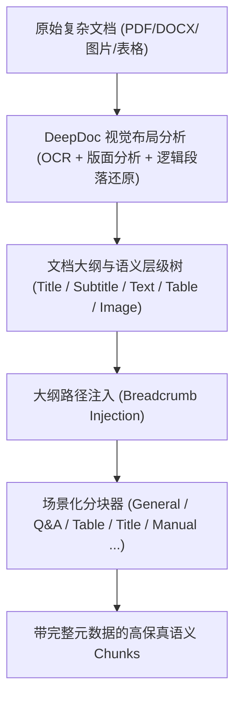
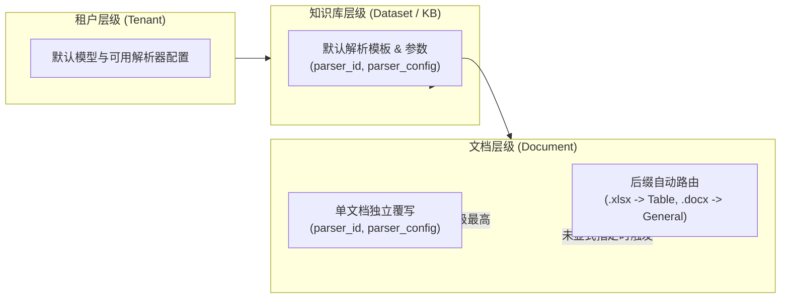
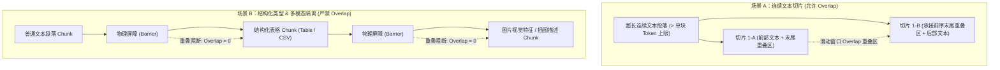
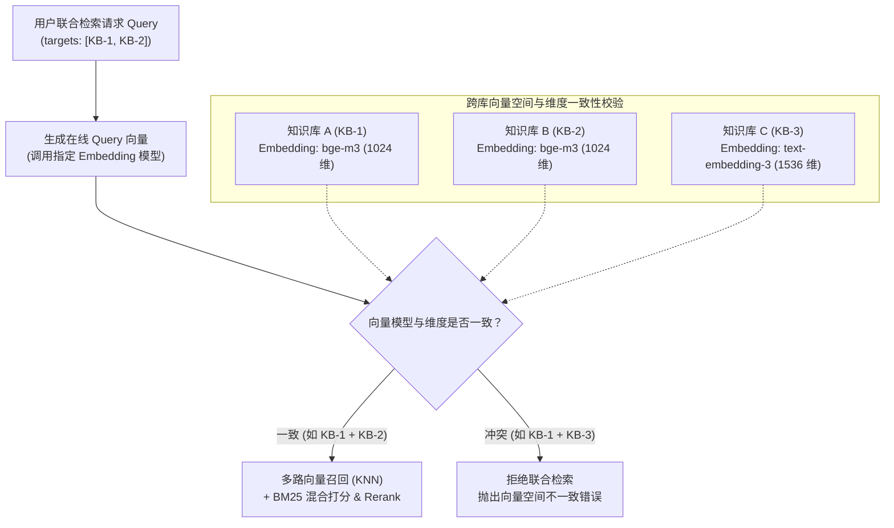
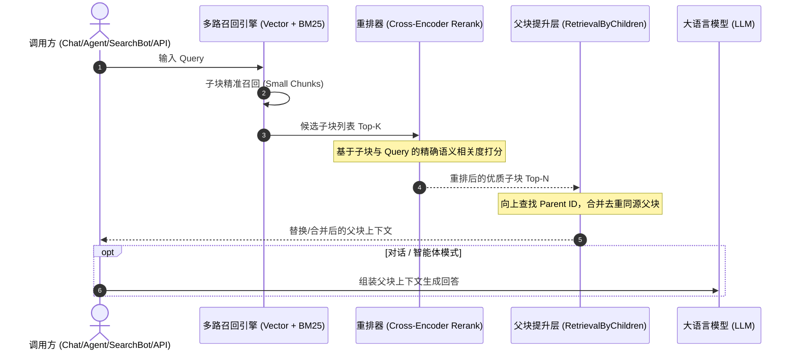
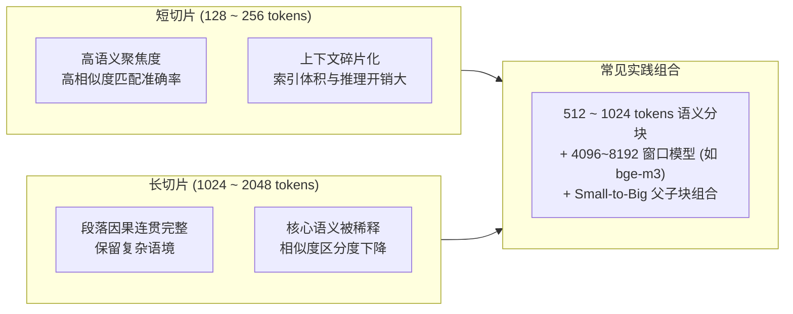
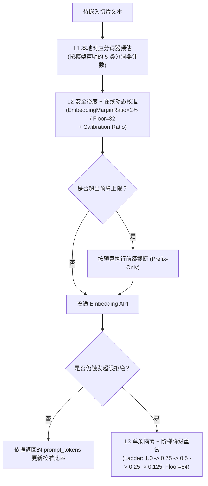
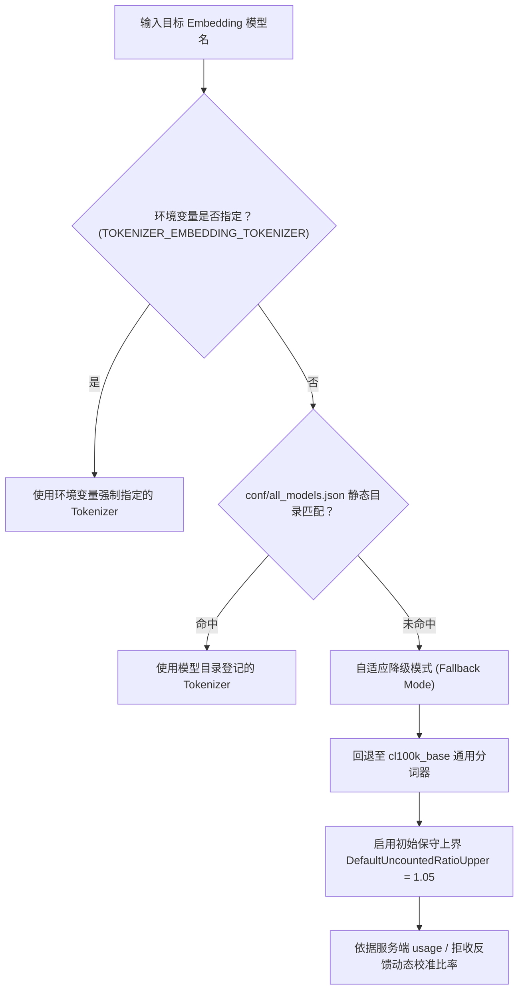

# RAGFlow 切片与向量生成技术架构深度解析

> **研究基线**：RAGFlow [`v1.0.0`](https://github.com/infiniflow/ragflow/releases/tag/v1.0.0)（commit `db1cd5929a7885a3074547791f5ecc4d2f891739`）
> **核心源码依据**：`upstream/ragflow/internal/entity/dataset.go`、`upstream/ragflow/internal/entity/document.go`、`upstream/ragflow/internal/ingestion/component/chunker/`、`upstream/ragflow/internal/service/nlp/retrieval.go`、`upstream/ragflow/internal/tokenizer/embedlimit.go`、`upstream/ragflow/internal/entity/models/embed_limit.go`

本文档系统梳理 RAGFlow `v1.0.0` 在文档切片（Chunking）、滑动窗口与边界保护、父子块检索提升（Small-to-Big）、向量生成以及 Embedding Token 三级防御机制中的底层设计哲学与源码实现细节。

---

## 目录

1. [设计哲学：从视觉布局理解到语义切片](#1-设计哲学从视觉布局理解到语义切片)
2. [切片模板矩阵与多级配置继承](#2-切片模板矩阵与多级配置继承)
3. [滑动窗口重叠机制与边界保护](#3-滑动窗口重叠机制与边界保护)
4. [向量生成与离线/在线预计算机制](#4-向量生成与离线在线预计算机制)
5. [父子块提升（Small-to-Big）检索架构](#5-父子块提升small-to-big检索架构)
6. [切片长度预算与模型窗口权衡](#6-切片长度预算与模型窗口权衡)
7. [三级防御工程架构：Token 预估、动态校准与安全截断](#7-三级防御工程架构token-预估动态校准与安全截断)
8. [模型与分词器的映射路由及动态自适应](#8-模型与分词器的映射路由及动态自适应)

---

## 1. 设计哲学：从视觉布局理解到语义切片

传统 RAG 方案常采用“纯文本盲切”（例如按固定字符数生硬切断），在处理复杂版式文档（PDF、扫描件、图文混排、多栏排版、跨页表格）时会带来严重的语义碎片化与信息污染。



### 1.1 视觉优先（Vision-First Layout Analysis）

RAGFlow 内置 DeepDoc 引擎，在切片前对文档进行版面元素级的物理还原：

- **多栏排版纠正**：识别论文与报刊的多栏结构，按阅读流逻辑串联，避免左右跨栏文本混杂。
- **跨页连续性还原**：消除硬分页导致的段落折断与孤行（如 `upstream/ragflow/internal/ingestion/component/chunker/general_pdf_continuation.go`）。
- **表格结构化提取**：将复杂跨单元格、合并单元格解析为结构化 HTML/Markdown，保留行列语义对齐。

### 1.2 大纲路径注入（Breadcrumb Injection）

当段落处于深层小节时，孤立检索往往缺失关键上下文（例如“第三季度同比增长 12%”脱离主体无法判别归属）。RAGFlow 会在切片元数据与向量化前缀中注入标题层级路径（如 `TitleChunker` / `HierarchyTitleChunker` / `GroupTitleChunker`），显著提升语义召回精准度并降低语义漂移。

---

## 2. 切片模板矩阵与多级配置继承

RAGFlow 避免用单一算法通吃所有知识模态，而是通过解析模板（`ParserType`）与注册分块器组件协同工作。

### 2.1 解析模板与分块器矩阵

实体层 `ParserType` 定义见 `upstream/ragflow/internal/entity/dataset.go:50-66`，实际注册的分块器组件见 `upstream/ragflow/internal/ingestion/component/chunker/names.go:19-30`（包括 `General`、`Token`、`Title`、`Manual`、`One`、`Page`、`QA`、`Table`、`GroupTitle`、`HierarchyTitle`）：

| 解析类型 (`parser_id`) | 适用场景 | 核心切分与重组逻辑 |
| :--- | :--- | :--- |
| **`general` / `naive`** | 通用文章、报表、技术文档 | 遵循自然段落与小节边界，支持滑动窗口重叠与标题上下文 |
| **`qa`** | 常见问答对、客服知识库 | 强绑定 Question 与 Answer 为完整语义单元 |
| **`table`** | 财务报表、参数清单、CSV/Excel | 逐行/逐块抽取并携带表头字段名，禁止跨行盲目重叠破坏行列关系 |
| **`laws`** | 法律法规、合规规章、政策条文 | 按编、章、节、条、款层级切分，保留法条编号与层级归属 |
| **`manual`** | 操作手册、设备说明书 | 以步骤和操作项为单元切分，保留前后置依赖说明与注意事项 |
| **`paper` / `book` / `presentation`** | 学术论文、书籍、PPT 演示稿 | 分别适配摘要/章节结构、长文层次目录与按页结构 |
| **`one`** | 简短文档、配置声明 | 整篇文档作为单个 Chunk，不做切分 |
| **`picture` / `audio` / `email` / `knowledge_graph`** | 图片、音频、邮件、知识图谱场景 | 对接多模态描述、语音转写、邮件头/正文解析或图谱抽取流水线 |

### 2.2 配置层级与动态继承

实体设计见 `upstream/ragflow/internal/entity/dataset.go:121` 与 `upstream/ragflow/internal/entity/document.go:27`：



1. **知识库默认基线**：创建知识库时指定默认 `parser_id`（默认 `general`）与 `parser_config`。
2. **文档级独立覆写**：同一知识库内允许不同文档独立覆写 `parser_id` 与切片参数。
3. **格式自动探测**：未显式指定时，按文件类型路由至对应的解析与分块路径。

---

## 3. 滑动窗口重叠机制与边界保护

重叠（Overlap）用于缓解长文本切分处的上下文硬截断，但并非对所有内容无差别启用。



### 3.1 触发与保护逻辑

在 `upstream/ragflow/internal/ingestion/component/chunker/general.go:472, 486, 1364`（`applyGeneralOverlap` 与 `applyGeneralOverlapWithSources`）中：

- **结构化类型隔离**：`Table`、`Q&A`、`Laws` 等强调记录独立性的模板关闭重叠，避免跨行或跨法条混杂内容。
- **跨多模态重叠阻断**：在通用文本切片重叠计算时，遇到 `itemDocType(unit) != "text"`（图片、表格等非纯文本块）即重置前序文本滑动窗口，阻断跨模态越界拼接：

```go
// 逻辑示意（对应 general.go 中的非文本阻断逻辑）
if itemDocType(units[i]) != "text" {
    previousText = -1 // 遇到图片、表格等非文本块，重置重叠链
    continue
}
```

---

## 4. 向量生成与离线/在线预计算机制



### 4.1 离线索引流水线 vs 在线 Query Embedding

- **离线流水线（Ingestion Pipeline）**：文档切块完成后，后台任务批量调用 Embedding 模型生成稠密向量，与分词倒排特征（BM25/全文索引）一并写入检索引擎（Infinity、Elasticsearch 或 OpenSearch）。
- **在线检索（Online Query）**：查询时调用相同的 Embedding 模型将 Query 向量化，执行向量召回与全文检索的混合排序。

### 4.2 跨库联合检索的一致性约束

在跨知识库联合检索（Multi-Dataset Search）中，所有参与检索的知识库必须使用**相同维度且处于同一向量空间的 Embedding 模型**（通常要求同一模型）。底层向量字段（如 `q_1024_vec`、`q_1536_vec`）与几何空间强绑定；不同向量空间的余弦相似度不可横向比较。

---

## 5. 父子块提升（Small-to-Big）检索架构

Small-to-Big 机制通过“子块精准召回与重排、父块上下文回填”平衡检索信噪比与生成上下文完整性。



### 5.1 为什么父块提升位于 Rerank 之后？

核心函数 `nlp.RetrievalByChildren` 实现于 `upstream/ragflow/internal/service/nlp/retrieval.go:1075`，并在以下核心检索入口调用：
- 知识库检索：`upstream/ragflow/internal/service/dataset/search.go:335`
- 切片检索服务：`upstream/ragflow/internal/service/chunk/chunk.go:443`
- 对话流水线：`upstream/ragflow/internal/service/chat_pipeline.go:808`
- Agent 检索桥接层：`upstream/ragflow/internal/agent/retrievalbridge/enhancer.go:116`

将 `RetrievalByChildren` 放在 Rerank 之后有三点工程收益：
1. **防止语义稀释**：短子块信息密度高，与 Query 计算向量相似度与 Cross-Encoder 交叉打分时信噪比最高；若先替换为长父块，冗余背景文本会摊薄核心得分。
2. **控制重排算力**：Cross-Encoder 推理复杂度随输入长度快速上升，对短子块重排耗时远低于长父块。
3. **过滤后再聚合**：仅对高分通过的子块回查父块并去重合并，避免拉取无关大段落。

---

## 6. 切片长度预算与模型窗口权衡



- **短切片（128~256 tokens）**：语义聚焦、命中率高，但易破坏段落因果且索引条目暴涨。
- **长切片（1024~2048 tokens）**：上下文完整，但长段铺垫会稀释核心语义向量表征。
- **小窗口 Embedding 模型风险**：若 Embedding 模型输入上限仅 512 tokens，扣除大纲路径前缀和元信息后正文预算非常紧张，容易导致文档切得过碎。实践中优先选用 4096~8192 上限的主流模型（如 `bge-m3`、`text-embedding-3-small/large`）。

---

## 7. 三级防御工程架构：Token 预估、动态校准与安全截断

许多云厂商与自托管 Embedding 服务（如 SiliconFlow、vLLM、llama-server）对输入长度施加**硬性上限**：只要一个 Batch 中有一条文本超出 `max_tokens`（哪怕仅超出 0.55%），即直接返回 `400 Bad Request`（如 SiliconFlow 错误码 `20015`）或 llama-server `500`（含 `"is too large to process"`），导致整批切片全部失败。

为此，RAGFlow 在 `upstream/ragflow/internal/tokenizer/embedlimit.go` 与 `upstream/ragflow/internal/entity/models/embed_limit.go` 中实现了三级防御机制（背景文档另见 `upstream/ragflow/internal/tokenizer/embedding_token_limits.md`）：



### 7.1 L1：本地精准分词预估

根据目标 Embedding 模型实际使用的分词算法，调用本地对应 Tokenizer 进行 token 计数，避免单纯依赖 `cl100k_base` 在数字表格或特殊字符上严重低估 token 数（实测在 XLM-R SentencePiece 等分词器上可能出现大幅偏差）。

### 7.2 L2：安全裕度与在线动态校准

源码常量见 `upstream/ragflow/internal/tokenizer/embedlimit.go:200-238`：

- **声明上限与安全裕度**：`EmbeddingMarginRatio = 0.02`（预留 2% 比例裕度），最低保底 `EmbeddingMarginFloor = 32` tokens；若模型完全未声明上限，保守默认 `EmbeddingTokenLimitDefault = 2048`。
- **动态比率校准（`Calibration`）**：根据服务端实际返回的 `prompt_tokens` 与本地预估值之比（`realCount / ownCount`）以及超限拒绝反馈持续更新上界系数，用于后续批次预缩放预算。

### 7.3 L3：超限识别、单条隔离与阶梯切削

源码见 `upstream/ragflow/internal/tokenizer/embedlimit.go:543-705` 与 `upstream/ragflow/internal/entity/models/embed_limit.go:131-180`：

- **精确错误识别（`IsOverLimitError`）**：识别带词边界的 `400`/`413`/`422` 搭配超限短语（`OverLimitMarkers`）或错误码 `20015`（`OverLimitCodes`），并特别兼容 llama-server 的 `500` + `"is too large to process"` 场景，同时防止把响应体中的数字误判成状态码。
- **单条隔离与阶梯缩容**：批次遇超限后拆散为单条独立重试，按比例因子 `[0.75, 0.5, 0.25, 0.125]` 逐步缩减预算，最低底线为 `OverLimitFloorTokens = 64` tokens；坏数据仅影响自身，不拖垮同批次健康切片。
- **为什么采用纯前缀截断（Prefix-Only）**：
  1. 绝大多数段落的主题句与核心实体集中在前半部分；
  2. 在应急容灾截断阶段不引入尾部拼接或额外 overlap，逻辑确定且避免拼接断句污染向量表征。

---

## 8. 模型与分词器的映射路由及动态自适应

### 8.1 内置的五类分词器标识

见 `upstream/ragflow/internal/tokenizer/embedlimit.go:69-73`：

1. **`cl100k_base`**（`CounterCL100K`）：OpenAI 系列（`text-embedding-ada-002`、`text-embedding-3-small/large`）及通用兜底。
2. **`xlmr-spm`**（`CounterXLMRSentence`）：XLM-RoBERTa SentencePiece 家族（如 `bge-m3`、`multilingual-e5`）。
3. **`bert-wordpiece`**（`CounterBERTWordPiece`）：经典 BERT / 中文 WordPiece 家族（如 `bge-small/base-zh`、`text2vec`）。
4. **`qwen-bpe`**（`CounterQwenBPE`）：Qwen BPE 体系 Embedding 模型。
5. **`llama-bpe`**（`CounterLlamaBPE`）：LLaMA BPE 体系 Embedding 模型。

### 8.2 分词器路由优先级

路由逻辑见 `upstream/ragflow/internal/entity/models/model.go:513-525` 与 `upstream/ragflow/internal/tokenizer/embedlimit.go:174, 217`：



1. **环境变量最高优先**：通过 `TOKENIZER_EMBEDDING_TOKENIZER`（以及上限覆写 `TOKENIZER_EMBEDDING_MAX_TOKENS`）强行绑定，适配私有部署或自定义网关。
2. **静态模型目录**：优先匹配 `upstream/ragflow/conf/all_models.json` 中登记的模型分词器配置。
3. **未知模型自适应兜底**：未命中目录或资产加载失败时回退到 `cl100k_base`，启用保守系数 `DefaultUncountedRatioUpper = 1.05`（预留 5% 上浮空间），并在运行过程中结合真实 `prompt_tokens` 与 L3 反馈动态校准。

---

## 总结

RAGFlow `v1.0.0` 在切片与向量生成链路上的核心工程特征可归结为两点：

1. **上游语义保真**：通过 DeepDoc 视觉版面还原、场景化分块器矩阵、标题路径注入与非文本重叠阻断，减少复杂文档在切块阶段的语义损失。
2. **下游稳定闭环**：通过 Rerank 后的 Small-to-Big 父块提升、五类本地分词器路由以及 L1/L2/L3 渐进防御机制，在保持召回精度的同时把 Embedding 批处理超限失败的风险收敛到单条最小影响面。
